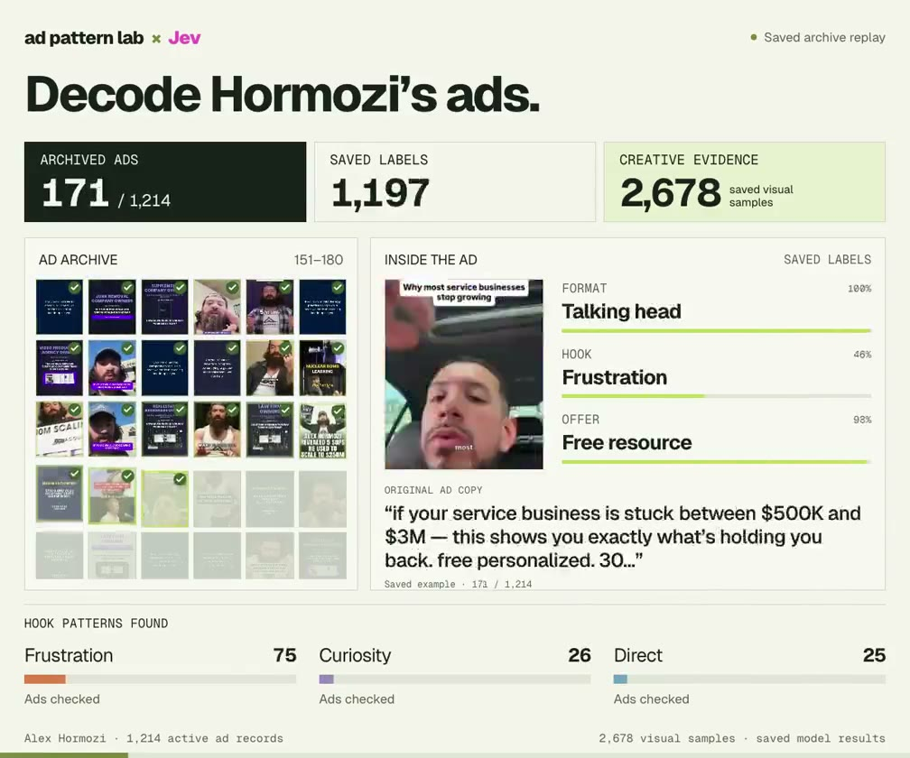

# Ad Lab

**Turn competitor ads into a searchable research library.** Jev reads creative images directly, classifies seven dimensions, and helps you find examples worth studying before you make your next ad.

[](https://novitckii.com/lib/ad-lab/demo.mp4)

[Watch the visual](https://novitckii.com/lib/ad-lab/demo.mp4) · [Free resource + setup guide](https://novitckii.com/resources/ad-lab/) · [Detailed setup](docs/SETUP.md) · [Verification](docs/VALIDATION.md) · [Data flow](docs/PRIVACY.md)

## Start with no keys

Install [Node.js](https://nodejs.org/en/download) 22.9 or newer, then:

```sh
git clone https://github.com/artemnovitckii/ad-pattern-lab.git
cd ad-pattern-lab
npm ci
npm run setup
npm start
```

Open **http://127.0.0.1:5194**. The bundled demo works without API keys. Filter format and hook, inspect individual ads, explore the findings, and replay the thumbnail wall and map together. Demo brands, labels, dates, brief scores and costs are fictional. Replay time is not measured API speed.

For your own research, install [FFmpeg](https://ffmpeg.org/download.html), add your TypeSafe key to `.env`, restart, and choose **Import ads**. Start with 5 to 10 creatives. Pasted copy and JSON imports work without FFmpeg; image preparation and video sampling need it.

```dotenv
ANALYSIS_PROVIDER=jev
TYPESAFE_API_KEY=your_typesafe_key
JEV_MODEL=jev-latest
```

No OCR installation or local language-model download is needed. Jev receives the actual creative images.

## How it works

1. **Collect or import.** Paste ad copy, upload images/videos, import JSON, or use the optional Apify Meta Ad Library connector.
2. **Prepare evidence.** FFmpeg converts a static creative into a JPEG, or samples up to four frames from a video. Optional Fireworks or Groq transcription adds the spoken words.
3. **Jev reads the images.** One typed request classifies **format, hook, angle, offer, proof, objection and CTA**. Images are uploaded directly through TypeSafe's native image API, alongside copy and any supplied transcript. Campaign age and outcome metrics are excluded from this request.
4. **Find patterns and examples.** Filter the archive, browse creative thumbnails on the map, compare the observed 60+ day share, and click an ad to see its evidence, labels and original source link.
5. **Plan your next test.** Supply your brand, audience and verified facts. Get editable brief outlines, or connect an optional chat-model writer for original drafts. Jev reviews clarity, brand fit and claim support.

**Native image support is experimental at TypeSafe.** The implementation uses `POST /v1/systemone`, multipart image assets and the required `TypeSafe-Danger-Zone-Images` header. Images are resized/padded to meet the documented limits. See [TypeSafe's image documentation](https://docs.typesafe.ai/images).

Jev classifies and reviews; it does not transcribe audio or write the prose briefs. Four frames do not constitute a complete video inspection. Unsupported labels remain unknown.

[Download the saved Hormozi findings](examples/hormozi-findings.csv) and [read the research notes](examples/hormozi-research-notes.md). This is a historical snapshot; provenance and limitations are included.

## Pick the features you need

| Feature | What you supply |
| --- | --- |
| No-key demo and recording variations | Nothing |
| Native visual classification | `TYPESAFE_API_KEY`; FFmpeg for images/video |
| Meta Ad Library collection | `APIFY_TOKEN`, a public library/page URL and an Apify budget cap |
| Speech transcription | Fireworks **or** Groq key; optional |
| Original prose briefs | Optional OpenAI-compatible chat API key/model |

The code is free. Provider usage is billed to your accounts. The Apify cap covers collection only, not Jev, speech or writing. Check a small pilot against your provider dashboards before increasing the batch.

## What the findings mean

The default creative landscape groups similar saved labels. Nearby thumbnails share classifications; positions are not a performance score. You can also view age versus observed family size. Each family uses an exact copy/media fingerprint, not perceptual image matching. Signed URL changes can split visually identical ads.

The pattern table compares **dated active ads that started at least 60 days earlier / dated active ads in that group**. The findings link to the underlying examples, including copy breakdowns. This is a useful shortlist for research. It does not reveal profitability, ad spend, CTR, CPA, ROAS or the probability that a new ad will succeed. A reported start date does not prove uninterrupted delivery.

Copy sections are saved ad copy, not a spoken transcript unless a transcript was actually supplied or generated. Review the original creative before relying on a label.

## Recording and simulation

Open **http://127.0.0.1:5194/variations.html** for light-mode recording layouts. The wall, map and counters follow a shared clock. Pause, restart and scrub without new API calls. A clean version:

```text
http://127.0.0.1:5194/variations.html?variant=reference&clean=1&duration=20
```

`C` toggles controls, `R` restarts and Space pauses. [Recording guide](docs/RECORDING.md).

The starter includes generated fictional artwork. You can optionally import your own local image folder with `npm run demo:images -- /path/to/images` or fetch a curated public reference pack with `npm run demo:download`. These packs change the illustration, not the simulation's synthetic findings. They are not complete Meta campaign datasets. [Image sources](docs/IMAGE-SOURCES.md).

## Saved results and privacy

Keys stay server-side in your ignored `.env`. Uploads, extracted frames, transcripts and caches stay in ignored `data/`. Jev receives images and supplied creative text; an enabled speech provider receives audio. This is a local development server bound to `127.0.0.1`, not an authenticated hosted app. [Data flow](docs/PRIVACY.md).

Imports replace the current batch; uploads append. Export before replacing a batch. Switching provider or analysis version explicitly queues old results for reanalysis when you press **Analyze / retry unfinished**. Prior costs and provenance remain intact. Saved replay makes no paid calls and does not turn historical results into a new Jev benchmark.

```sh
npm run doctor  # Checks tools and key presence; no paid requests
npm run check
npm test
```

[Full installation, keys, Apify collection, limits and troubleshooting](docs/SETUP.md).

Built by [Artem Novitckii](https://novitckii.com). Independent of Meta, Apify and TypeSafe. Code is MIT licensed. Third-party ad material remains the property of its owners.
